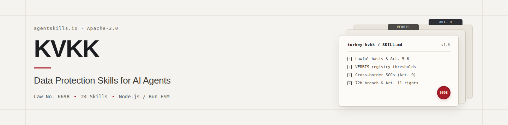

<p align="center">
  
</p>

# Turkish KVKK Compliance Engineering Skills (Law No. 6698 / Law No. 7499 - Nov 2026)

A lean, high-signal, 100% Turkish-law-native compliance engineering skill pack consisting of **5 specialized [agentskills.io](https://agentskills.io) skills** backed by **zero-dependency Node.js / Bun ESM (`*.mjs`) automation scripts** and a deterministic **E2E verification suite**.
Every skill is anchored to Law No. 6698 (as amended by Law No. 7499, post-June 2024 Article 6 and post-September 2024 Article 9) and verified KVKK Board Decisions as of November 2026.

[](LICENSE)
[](#skills-5)
[](https://agentskills.io)
[-brightgreen.svg)](#verification--testing)

---

## Disclaimer

These skills, templates, and automation scripts are **technical compliance engineering tools**, not formal Turkish legal advice (*hukuki mutalaa*).
Consult qualified Turkish legal counsel before regulatory filings, Standard Contract execution, VERBIS submissions, or formal DSAR/breach determinations.

---

## Quick Start

Install with the open Skills CLI (`skills.sh`, works across Claude Code, Cursor, Codex, Copilot, and Gemini CLI):
```bash
npx skills add anylogy/kvkk
```

Install with Gemini CLI:
```bash
gemini extensions install https://github.com/anylogy/kvkk
# or install skills directly
gemini skills install https://github.com/anylogy/kvkk
```

Install with Antigravity:
```bash
agy plugin install https://github.com/anylogy/kvkk
```

Or clone and run scripts locally (requires Node.js 20+ or Bun, zero `npm install` required):
```bash
git clone https://github.com/anylogy/kvkk.git
cd kvkk
node scripts/validate-repo.mjs
node tests/run-all.mjs
```

---

## Skills (5)

| Skill | Subdomain | Statutory Scope | Automation Script |
|:---|:---|:---|:---|
| [`kvkk-core-law-2026`](skills/kvkk-core-law-2026/SKILL.md) | `kvkk-compliance` | Art. 5 & unified Art. 6/3 bases, VERBIS thresholds (Decisions 2023/1154, 2025/1572, 2025/2393), 2026 Art. 18 fines, TCK 135-140, KVKK-vs-GDPR terms | [`check-verbis-threshold.mjs`](skills/kvkk-core-law-2026/scripts/check-verbis-threshold.mjs) |
| [`kvkk-frontend-audit`](skills/kvkk-frontend-audit/SKILL.md) | `frontend-privacy-engineering` | Browser Art. 9 leak scan, Cookie Guidelines, layered *Aydinlatma* vs. *Acik Riza*, ETK/IYS decoupling, strict `'self'` CSP | [`scan-frontend-leaks.mjs`](skills/kvkk-frontend-audit/scripts/scan-frontend-leaks.mjs) |
| [`kvkk-backend-architecture`](skills/kvkk-backend-architecture/SKILL.md) | `backend-privacy-engineering` | Append-only PostgreSQL consent ledger, Board Decision 2018/10 controls, 6-month *Periyodik Imha*, Law 5651/VUK carve-outs | [`validate-inventory.mjs`](skills/kvkk-backend-architecture/scripts/validate-inventory.mjs) |
| [`kvkk-cross-border-art9`](skills/kvkk-cross-border-art9/SKILL.md) | `cross-border-transfers` | Post-Sept 2024 Art. 9 3-tier hierarchy, Standard Contracts (SS-1 to SS-4), 5-business-day filing SLA, sovereign infra checks | [`audit-subprocessors.mjs`](skills/kvkk-cross-border-art9/scripts/audit-subprocessors.mjs) |
| [`kvkk-dsar-breach-ops`](skills/kvkk-dsar-breach-ops/SKILL.md) | `dsar-and-breach-ops` | Art. 11 DSAR (30-day SLA), 72-hour Board breach notice (2019/10), subject breach notice (2019/271), SHA-256 doc pinning | [`verify-legal-hashes.mjs`](skills/kvkk-dsar-breach-ops/scripts/verify-legal-hashes.mjs) |

---

## Script Usage Examples

```bash
# 1. Evaluate VERBIS exemption using annual employee count and balance sheet total (TRY)
node skills/kvkk-core-law-2026/scripts/check-verbis-threshold.mjs \
  --employees 9 \
  --balance-sheet-try 8500000 \
  --art6-primary \
  --json

# 2. Scan a frontend project for Art. 9 third-party leaks, pre-checked consents, and PII storage
node skills/kvkk-frontend-audit/scripts/scan-frontend-leaks.mjs \
  --target /path/to/frontend \
  --allow-domain app.example.com.tr \
  --strict-placeholders \
  --json

# 3. Validate a Kisisel Veri Isleme Envanteri JSON against Nov 2026 statutory rules
node skills/kvkk-backend-architecture/scripts/validate-inventory.mjs \
  --file /path/to/KVKK_INVENTORY_SEED.json \
  --json

# 4. Audit vendor/subprocessor manifest for Art. 9 transfer basis and 5-business-day SCC deadlines
node skills/kvkk-cross-border-art9/scripts/audit-subprocessors.mjs \
  --file /path/to/subprocessors.json \
  --json

# 5. Verify legal text SHA-256 hashes and detect unfilled [PLACEHOLDER_...] tokens
node skills/kvkk-dsar-breach-ops/scripts/verify-legal-hashes.mjs \
  --dir /path/to/legal-docs \
  --manifest /path/to/legal-docs/manifest.json \
  --json
```

All scripts also run identically under Bun (`bun skills/.../scripts/*.mjs`).

---

## Verification & Testing

Run the repository integrity linter (frontmatter validation, zero em-dash enforcement, anti-hallucination guardrails, and CLI `--help` smoke checks) and the fixture-driven E2E test suite:

```bash
node scripts/validate-repo.mjs && node tests/run-all.mjs
# or with Bun
bun scripts/validate-repo.mjs && bun tests/run-all.mjs
```

---

## Contributing

Contributions are welcome from privacy engineers, security architects, and Turkish KVKK practitioners.
Please review [CONTRIBUTING.md](CONTRIBUTING.md) before opening a pull request so all statutory citations, Markdown formatting rules, and E2E fixtures stay green.

---

## Attribution

Maintained by [Anylogy](https://github.com/anylogy).
Forked from [Privacy-Data-Protection-Skills](https://github.com/mukul975/Privacy-Data-Protection-Skills) by [Mahipal](https://github.com/mukul975) under the Apache License 2.0.

---

## Cite This Repository

```bibtex
@misc{anylogy2026kvkkskills,
  author       = {Anylogy and Mahipal},
  title        = {Turkish KVKK Compliance Engineering Skills for AI Agents},
  year         = {2026},
  publisher    = {GitHub},
  url          = {https://github.com/anylogy/kvkk},
  version      = {2.0.0},
  note         = {Forked from Privacy-Data-Protection-Skills by Mahipal; refactored into 5 Turkish-law-native skills following agentskills.io}
}
```

---

## License

Apache 2.0.
See [LICENSE](LICENSE) and [NOTICE](NOTICE) for details.

Copyright 2025-2026 Mahipal (Original Work)
Copyright 2026 Anylogy (Fork Modifications)
